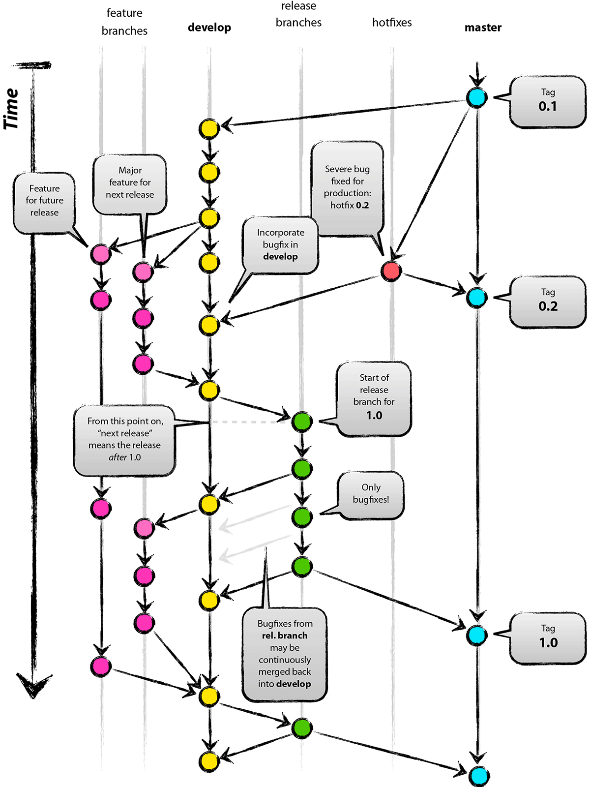

# Git and GitHub workflow

This chapter is a short summary of the commands you need, not a guide to git.

## Branches

bmm follows a [git-flow](https://jeffkreeftmeijer.com/git-flow/) model. `master` holds the latest release and `develop` the next one. Features planned for a later release collect on integration branches named after that release (`dev-x.y.0`), which are merged into `develop` when their release opens. You branch from one of `develop` or `dev-x.y.0` (see @sec-setup) and open your pull request against the same branch.



## Git commands

[Add](https://www.atlassian.com/git/tutorials/saving-changes) your changes, [commit](https://www.atlassian.com/git/tutorials/saving-changes/git-commit) them and [push](https://www.atlassian.com/git/tutorials/syncing/git-push) them to your fork, from any terminal with the repository as the working directory.

Stage specific files rather than everything with `git add .`, which can pick up files you did not mean to commit, such as fitted model objects:

``` bash
git add R/model_my_model.R inst/stan_chunks/my_model_functions.stan
git commit -m "A short message describing the change"
git push
```

Repeat as often as you like before opening the pull request. Small, self-contained commits are easier to review.

Do not commit fitted models. A CI check fails the pull request if any of its commits adds a file over 1 MiB, even if a later commit removes it again; CONTRIBUTING.md says how fits for articles are handled instead.

## Pull requests

Open the pull request from your fork on GitHub, against the branch you started from. The pull request template asks for what the reviewer needs, with an extra checklist for a new model; fill it in. Review tiers, the recovery evidence a new model needs, and the policy on AI-assisted contributions are in [CONTRIBUTING.md](https://github.com/popov-lab/bmm/blob/develop/.github/CONTRIBUTING.md).

If you use AI tools, read @sec-conventions before you open the pull request. The ways code generated by a language model typically departs from bmm's style are the ones that chapter lists: validation in internal helpers, base `stop()` and `sprintf()`, a final `return()`, comments that restate the code, and a recovery study that simulates and fits with the same function.
