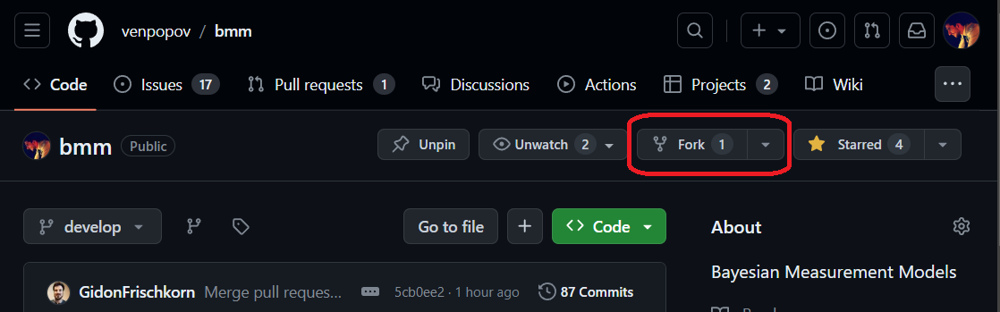

# System setup {#sec-setup}

## Setting up a local fork of the bmm repository

1.  Fork the bmm GitHub repository. This creates a copy of the repository in your own GitHub account.

    

2.  [Clone](https://docs.github.com/en/repositories/creating-and-managing-repositories/cloning-a-repository) your fork to your local machine, and add the main repository as a remote so that you can keep your branch up to date: `git remote add upstream https://github.com/popov-lab/bmm.git`.

3.  Create a branch for your model. Branch from `develop`, or, if the issue for your model is planned for a later release, from that release's integration branch (`dev-x.y.0`); the issue's milestone tells you which. Name the branch after the issue, as `<issue-number>-short-description` (for example `349-lba-model`), so that branch, issue and pull request are easy to line up.

## Prerequisites

The bmm package requires **R \>= 4.1.0** (for the native pipe `|>`). It works with both the `rstan` and the `cmdstanr` backend. We recommend `cmdstanr`, which compiles faster and gives better error messages, and the tests that compile Stan code need it:

``` r
install.packages("cmdstanr", repos = c("https://stan-dev.r-universe.dev", getOption("repos")))
cmdstanr::install_cmdstan()
```

Once bmm is loaded (with `load_all()`, below), `bmm_setup()` checks the C++ toolchain, `cmdstanr` with CmdStan, `rstan`, and the backend `bmm()` will use. It then compiles and samples a small test model and suggests a fix for every check that failed. Run it before your first fit.

## Package development with devtools

Development runs on the `devtools` package, whichever editor you work in. The repository ships a `bmm.Rproj` file, so opening it in RStudio or Positron starts a session in the package root; in any other editor, start R in the repository directory. [R Packages](https://r-pkgs.org/) is the standard tutorial. The steps you will repeat:

1.  Install the development tools and bmm's dependencies once:

    ``` r
    install.packages(c("devtools", "roxygen2", "testthat", "knitr"))
    library(devtools)
    install_dev_deps()
    ```

2.  Load the package from your local files whenever you change the code:

    ``` r
    load_all()  # ctrl+shift+L in RStudio
    ```

    Do not call `library(bmm)` or source the files, as that loads the installed version, not the one you are working on.

3.  Before you open a pull request, regenerate the documentation, run the tests and check the package, in this order:

    ``` r
    document()  # regenerates man/ and NAMESPACE; never edit those by hand
    test()
    check()     # 0 errors, 0 warnings; explain any note in the pull request
    ```

## Running the tests

`test()` runs `tests/testthat/` in parallel. Two kinds of test there skip themselves when your machine cannot run them:

-   Tests that compile Stan code need CmdStan. Set `BMM_TEST_STAN=false` in your environment to skip them deliberately.
-   Tests that read a stored fit need `tests/testthat/assets/`, which is left out of the built package, so they skip inside `check()`.

Tests that actually sample live in `tests/local/` and never run in `test()` or `check()`. They are not required for a pull request, because a weekly CI job runs them, but you can run them with `Rscript tests/local/run.R`. Run `test(reporter = "slow")` before a pull request as well: the suite has a time budget that CI enforces, and this reporter shows which of your tests are slow. @sec-add-new-model says which tests a new model needs.

## Untracked scratch work

Development produces files that belong on your machine rather than in the package: exploratory scripts, fitted model objects, scratch data. bmm's `.gitignore` excludes a `local/` folder at the root of the repository for this purpose, so anything you put there stays out of your commits. (`tests/local/` is a different folder and is tracked.) Your parameter recovery script can live there, but the reviewer has to see its results; @sec-add-new-model says how.
